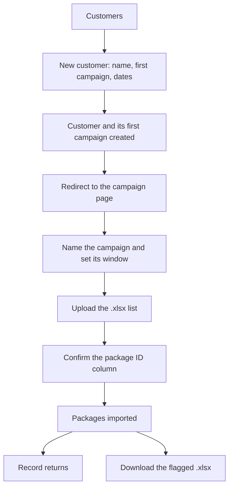

# Design: the app end to end — set up a customer, run its campaigns, record returns

**Status: draft, awaiting your approval. No code has been written from this document.**
Date: 2026-10-16 · Supersedes nothing; `SPECIFICATION.md` remains the original PRD.

---

## 1. What this document is

One page that describes how the whole app is meant to work, from *add a customer* to *download the
flagged `.xlsx`*. It exists because the app has been changed one item at a time, and the items have
started to disagree with each other. It ends with where each question stands.

**Two things are settled and are not on the table — the invariants in §11.**

---

## 2. The finding that decides everything else

You created **`plátano de canarias 2026`** just now (customer 12). The app did the right thing and
created its first campaign with it (campaign 10). Then that campaign could not be opened:

| You are `owner@mycompany.test` | Result |
|---|---|
| `GET /campaigns/10` — open the campaign page | **404** `campaign not found` |
| `GET /campaigns/10/uploads` — its lists | **404** |
| `POST /campaigns/10/packages` — upload a list | **403** `this account is not attached to a company` |
| `GET /returns/campaigns/10` — its returns screen | 200, works |

**Root cause: the app has two different rules about who may touch a campaign.**

- **Returns** follow "the boundary is the request, not the account" (`SECURITY.md` finding 21). The
  request names the campaign, and whoever is allowed to ask gets an answer. This is why the returns
  screen works.
- **Campaigns, packages and uploads** follow "the account decides". Every query is scoped to the
  caller's own `customer_id`. You have **none** — the cleanup left both remaining super-admins
  (`owner@mycompany.test`, `root@platform.test`) attached to no company — so every campaign route
  answers 404 or 403.

So today a **platform** super-admin can set things up (customers, accounts, campaigns) but cannot work
in what they set up: no opening, no uploading, no lists, and *Returned Packages* reads "not attached
to a company". Your flow 2 lands exactly in that hole.

---

## 3. The decision — settled: **Model A**

**Approved 2026-10-16.** *The super-admin works anywhere the request names.*
Extend the request boundary from returns to campaigns, packages and uploads: the campaign named by the
request decides its company, so a platform super-admin can open, rename, re-date and upload into any
campaign; a company super-admin still only ever reaches its own.

- Matches your flow 2 exactly: create the customer → land on its campaign → name it → upload, in one session.
- Matches the rule the returns screen already follows, so the app stops having two.
- **Not a tenancy loosening:** a company super-admin stays pinned to its own company, and only a
  *super-admin* may reach any of it. The existing isolation tests keep passing and gain new siblings.

**Model B — each customer gets its own super-admin.** Creating a customer also creates its first
account, and that account does the work.
- No API change at all: the existing routes already work for an account that has a company.
- But you must log out and log back in as the customer to upload, which contradicts flow 2 as you
  described it.

**Model C — attach you to a company (the five-minute fix).** Re-attach `owner@mycompany.test` to a
customer. Everything works again immediately.
- But you could then only create campaigns for **that** company, which breaks the company selector you
  asked for in item 4. Best kept in reserve, not as the answer.

**Decision: A**, approved by the owner on 2026-10-16. B and C are kept above only for the record.

---

## 4. Roles

| Role | Who | What they may do |
|---|---|---|
| `superadmin` | you, and each customer's manager | Customers, accounts, campaigns, uploads, the returns screen, the reports and the `.xlsx` |
| `user` | a store-side operator | The customers → campaign → returns screen only. No customers, no campaigns, no uploads, no reports |

Two more facts that matter for the design:

- A **platform** super-admin has no company (`customer_id` is NULL). Under Model A that means "works
  everywhere, owns nothing".
- A **company** super-admin has a company and is pinned to it.

**A super-admin may also act as a user** (built 2026-10-16). A **new top-level menu item, *Process
returns***, is the way in: clicking it puts the app into the user's view and lands on the user's starting
screen — the customer list — from where the operator's flow works exactly as it does for a `user`: pick the
customer, pick the campaign, use the package return functionality. While in that view the admin items
(*Campaigns*, *Returned Packages*) and every admin control are hidden, so the menu is **`Customers`
alone**, and a `user view` chip marks where you are; getting back to the super-admin view takes a **fresh
login**. This is a **view, not a permission**: the account stays a super-admin and the API still allows it
everything.

---

## 5. The process, end to end

### Flow 1 — a new customer and its first list *(your point 2)*

> **Settled — R1, option (iii).** The campaign is created with the customer, then you name it and date it
> on its own page before uploading. So the New customer form asks for the **customer's name only**.

1. **Customers → *New customer*.** One field: **Name**. Nothing else — no campaign name, no dates.
2. **Create.** The customer and its first campaign are created together, in one request; the campaign
   starts named after the customer and dated today.
3. **You land on that campaign's page** (`/campaigns/:id`). *This redirect is new.*
4. On the page: the campaign's **name** and **window** are shown and **editable**, and *Add a list to
   this campaign* is open. *The rename/date editor is new — the API for it already exists and no screen
   uses it today.*
5. **Pick the `.xlsx`**, confirm which column holds the package ID, **import**. The page reports
   `N lines imported`.
6. From there: **Record returns →** (`/campaigns/:id/returns`) or **Download the flagged `.xlsx`**.

### Flow 2 — a campaign for a customer that already exists *(your point 3)*

1. **Campaigns → *New campaign*.** Fields: **Company** (a platform super-admin chooses from every
   customer; a company super-admin is fixed to its own), **Name**, **Start date**, **Finish date**.
2. **Create.** It appears in the list, with its company named beside it.
3. **Click it** → the campaign page of Flow 1, step 4. *(Today this is a 404 — section 2.)*

### Flow 3 — the operator records a return

Customers → the customer's row → its **Campaigns** → **Record returns →** → type the package ID → the
match and its chain appear → pick a reason → if it went out again, save the resend. The campaign's own
counters move as they work.

### Flow 4 — the report and the `.xlsx`

**Reached through the customer, like everything else** (option 2). A campaign's results screen
(`/campaigns/:id/returns`) holds, top to bottom:

1. the **three counters** — packages sent · returned packages (`n% of sent`) · Resent (`n% of sent`);
2. the package lookup, the reason buttons and the resend form — the operator's work;
3. the **linking table** for that campaign: Original ID · Resent as · Resent again as · return reason
   *(no campaign column: on a campaign's own screen it would repeat the same name on every row)*;
4. **Download `.xlsx`** for that table, and for the campaign's whole list.

*The company-wide “Returned Packages” page is retired — see R3.*

---

## 6. Screens

| Screen | URL | Who | Purpose |
|---|---|---|---|
| Log in | `/login` | anyone | — |
| **Customers** | `/customers` | both | The home screen. Each row opens (accordion) to its **Campaigns** and, for a super-admin, its **Accounts** |
| **Campaigns** | `/campaigns` | super-admin | Create a campaign for a company; every list under its campaign |
| **Campaign page** | `/campaigns/:id` | super-admin | One campaign: edit its name/window, upload its lists |
| **Campaign returns** | `/campaigns/:id/returns` | both | The operator's desk *and* that campaign's report: the counters, the lookup, the reason, the resend, the linking table and its `.xlsx` |

A super-admin sees four items: **`Customers · Campaigns · Returned Packages · Process returns`**.
*Process returns* is the **way into the user's view** (§4) — it hides the admin items and lands on the
customer list, exactly where a `user` starts. While in that view the nav is **`Customers` alone**. What
becomes of *Returned Packages* itself (R3) is still to be applied.

---

## 7. What changes from today

| Area | Today | Proposed |
|---|---|---|
| New customer | Creates the customer + its first campaign, named after it, and stays on the list | Asks for the **customer's name only**, then **redirects to the new campaign's page** |
| Campaign page | Name and window are read-only; no rename, no re-date | **Editable**, and a *Record returns →* link |
| Campaign page, as a platform super-admin | **404** | **Opens** (Model A) |
| Uploading a list, as a platform super-admin | **403** | Imports into the campaign's own customer (Model A) |
| Campaigns list → click a campaign | 404 for a platform super-admin | Opens the campaign page |
| `← Campaigns` link on the campaign page | Points at `/`, which is now the customers — **a live bug from the last change** | Points at `/campaigns` |
| *Returned Packages* in the menu | A report page that shows a platform super-admin nothing at all | Not yet done (R3): its report moves onto each campaign's results screen. Left alone for now. |
| Customer names | Two customers may differ only by case; that is how `Plátano de Canarias 2026` and `plátano de canarias 2026` both existed | **One name per customer.** `customers.name` has no unique index today; a duplicate must be refused with a friendly `409` |
| A super-admin acting as a user | Not possible at all | **Built:** a new top-level **Process returns** item → the user's view (customer list, then campaign, then the package return functionality), admin items hidden, a `user view` chip shown; back via a **fresh login** |
| Campaign results counters | Exist: packages sent · returned packages (`n% of sent`) · Resent (`n% of sent`) | **Unchanged** — confirmed |

---

## 8. Success criteria

1. A platform super-admin creates a customer and arrives at that customer's campaign page with **no 404**.
2. From that page they upload a list, and the packages land in **that customer**, not nowhere.
3. They can rename the campaign and change its window from that page.
4. A company super-admin still cannot read or write another company's campaign — the existing isolation
   tests keep passing unchanged, and new ones cover the platform case.
5. A `user` still cannot create a customer, create a campaign, or upload a list.
6. Only a platform super-admin may choose a company when creating a campaign; a company super-admin is
   pinned to its own.
7. The **linking table** and its `.xlsx` download appear on each campaign's results screen.
8. Clicking **Process returns** puts a super-admin into the user's view — admin items hidden, the
   operator's flow working as it does for a `user` — and a fresh login brings the super-admin view back.

---

## 9. Boundaries

- **Always:** keep every existing isolation test green; a company super-admin never reaches another
  company's data; every new route is added to the anonymous-401 table.
- **Ask first:** changing the tenancy rule itself (this document), dropping `requireCompany` from a
  route, adding a dependency.
- **Never:** let a `user` reach customers, campaigns, uploads or reports; invent trial data in the live
  database; weaken a test to make a change land.

---

## 10. Where the questions stand

### Settled on 2026-10-16

| # | Answer |
|---|---|
| **Q1** | **Model A.** The super-admin works in any campaign the request names; a company super-admin stays pinned to its own company. |
| **Q2** | After a customer is created, **go straight to the campaign page** — not back to the customer list. |
| **Q5** | **No.** Each customer does **not** get its own log-in account. Accounts stay added by hand from the customer's row. |
| **Q6** | **Correct** — the extra table once floated for the returns screen stays deferred. |
| **Q7** | Customers **9 and 10 are deleted** (done). **New rule: two customers may not share a name** — `Plátano de Canarias 2026` and `plátano de canarias 2026` must not both be possible. |

### R1 — settled: option **(iii)**

Create the customer → the campaign is created with it → you land on that campaign's page → you name it
and set its window there → then you upload the list.

One mechanical note: `campaigns.name` is `NOT NULL`, so a truly nameless row is not possible. The
auto-created campaign therefore starts with a **provisional name — the customer's own name**, as today —
and the campaign page opens with the name field **focused and selected**, so your first keystroke replaces
it. It never reads blank in a list. *(The alternative — making `name` nullable and printing “Untitled” —
needs a migration and shows blank names in the campaign list; not recommended.)*

### R2 — settled: a new **Process returns** item is the way in

A new item in the top menu — **Process returns** — takes a super-admin into the user's view: it hides the
admin items and lands them on the customer list, which is where a `user` starts. From there the operator's
flow is unchanged — pick the customer, pick the campaign, use the package return functionality.

While that view is on, the menu is **`Customers` alone**, a `user view` chip marks it, and the admin
controls (*New customer*, *Accounts*, the export buttons) are hidden — a clean operator view. **Getting
back to the super-admin view takes a fresh login**, as you asked, so the view survives navigation and a
reload.

*(An earlier idea — reusing the *Returned Packages* item as the way in — was set aside on 2026-10-16: it
stays a report page.)*

**This is a view, not a permission.** The account is still a super-admin, so the API still permits it
everything (Model A). The view changes what is on screen, not what is allowed. Making the restriction real
would be a different piece of work.

### R3 — settled: option **2** — the report moves under each campaign

The counters stay exactly as they are. And the *Returned Packages* page is **retired**: its contents —
the **linking table** (Original ID · Resent as · Resent again as · return reason) and its **`.xlsx`
download** — move onto each campaign's own results screen, where the counters already are. So the report
is always read in the context of the campaign it belongs to, and there is one less page in the menu.

One consequence: the **campaign column disappears** from the linking table, because on a campaign's own
screen it would repeat the same name on every row. Nothing else about *Returned Packages* changes — it
stays a report page, and is no longer also the way into the user's view (R2).

### Nothing open

Every question raised so far is settled. The design is ready to be turned into a plan and a task list —
and, on your word, into code.

---

## 11. Invariants — these do not change

Both restated by the owner on 2026-10-16. They are easy to lose sight of while everything else moves, so
they are written down, and every task must be checked against them.

1. **A customer's campaigns stay on the Customers page.** Opening a customer's row shows its **campaign
   list** — each row reading `name · dates · N lines · N packages · M returns` — and clicking one opens
   that campaign's returns screen. For a super-admin the `.xlsx` download controls sit beside each
   campaign (*Download .xlsx*, and *Save as…* where the browser allows it). This list is how a campaign
   is reached, and it stays.
2. **Creating a campaign always names the customer.** The *New campaign* form keeps its **Company**
   selector, listing every customer. Only a platform super-admin may use it; an account attached to a
   company is pinned to its own, and naming another is refused. Neither half may be dropped: a campaign
   must never be creatable without saying which customer it belongs to.

*Where they live today:* the campaign list is `src/pages/CustomersPage.tsx` (the expansion under each
customer row); the Company selector is `src/pages/CampaignsPage.tsx` (the *New campaign* form).
