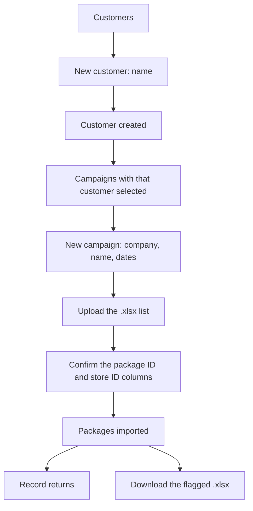

# Design: the app end to end — set up a customer, run its campaigns, record returns

**Status: implemented.** This is the 2026-10-16 design record; the current implementation is
summarized in §1a. Date: 2026-10-16 (current-state note added 2026-10-19). `SPECIFICATION.md` remains
the original PRD.

---

## 1. What this document is

One page that describes how the whole app is meant to work, from *add a customer* to *download the
flagged `.xlsx`*. It exists because the app has been changed one item at a time, and the items have
started to disagree with each other. It ends with where each question stands.

**Two things are settled and are not on the table — the invariants in §11.**

---

## 1a. Current implementation (2026-10-19)

The flows below are the design record; this is what the app does now.

- **Languages:** the app opens in **Spanish**. An **ES / EN** switch in the header keeps the original
  English available. Administrators edit both columns in **Traducciones** (`/translations`), grouped by
  screen and role; the live copy is in MySQL `translations`, seeded from `shared/translations.ts`.
  Operators cannot open the editor. Server API error messages remain English.
- **Customers:** an administrator sees **ID · Name · Delete** only (no row expansion). An operator's
  row expands to its campaigns, with **Record returns** and the **Return package list** accordion.
- **Campaigns:** the administrator screen has an independent customer selector, active campaigns first,
  a **Closed campaigns (n)** accordion, and per campaign: lists, **Return package list** (with the
  category chart), **Returns + Store ID**, and **Results file download**. The campaign page currently
  shows the campaign and its upload; the name/window editor described in §7 is still a pending design
  item.
- **Campaign returns screen:** counters, package lookup, reason picker, label details and resend row;
  **Return package list** (two tables + **Returned packages by category** chart) for both roles;
  **Returns + Store ID** for administrators only.
- **Downloads:** administrator only. Operators can read every table and chart but have no Download or
  Save as controls; the export routes return **403** for a `user` role.
- **Navigation:** administrator view `Clientes · Campañas · Usuarios · Traducciones`; operator view
  `Clientes` only. The login door chooses the view; the account role does not change.
- **Verification:** 272 tests, `npm run typecheck:api`, `npx tsc --noEmit`, `npm run build`.

---

## 2. The finding that decides everything else

> **Historical note:** this finding and the Model A decision below are from 2026-10-16. Model A is
> implemented; see §1a for the current state.

You created **`plátano de canarias 2026`** just now (customer 12). The app did the right thing and
created its first campaign with it (campaign 10). Then that campaign could not be opened:

| You are `owner@mycompany.test` | Result |
|---|---|
| `GET /campaigns/10` — open the campaign page | **404** `campaign not found` |
| `GET /campaigns/10/uploads` — its lists | **404** |
| `POST /campaigns/10/packages` — upload a list | **403** `this account is not attached to a company` |
| `GET /returns/campaigns/10` — its returns screen | 200, works |

**Root cause: the app has two different rules about who may touch a campaign.**

- **Returns** follow "the boundary is the request, not the account" (`SECURITY.md` finding 21). The
  request names the campaign, and whoever is allowed to ask gets an answer. This is why the returns
  screen works.
- **Campaigns, packages and uploads** follow "the account decides". Every query is scoped to the
  caller's own `customer_id`. You have **none** — the cleanup left both remaining super-admins
  (`owner@mycompany.test`, `root@platform.test`) attached to no company — so every campaign route
  answers 404 or 403.

So today a **platform** super-admin can set things up (customers, accounts, campaigns) but cannot work
in what they set up: no opening, no uploading, no lists, and *Returned Packages* reads "not attached
to a company". Your flow 2 lands exactly in that hole.

---

## 3. The decision — settled: **Model A**

**Approved 2026-10-16.** *The super-admin works anywhere the request names.*
Extend the request boundary from returns to campaigns, packages and uploads: the campaign named by the
request decides its company, so a platform super-admin can open, rename, re-date and upload into any
campaign; a company super-admin still only ever reaches its own.

- Matches your flow 2 exactly: create the customer → land on its campaign → name it → upload, in one session.
- Matches the rule the returns screen already follows, so the app stops having two.
- **Not a tenancy loosening:** a company super-admin stays pinned to its own company, and only a
  *super-admin* may reach any of it. The existing isolation tests keep passing and gain new siblings.

**Model B — each customer gets its own super-admin.** Creating a customer also creates its first
account, and that account does the work.
- No API change at all: the existing routes already work for an account that has a company.
- But you must log out and log back in as the customer to upload, which contradicts flow 2 as you
  described it.

**Model C — attach you to a company (the five-minute fix).** Re-attach `owner@mycompany.test` to a
customer. Everything works again immediately.
- But you could then only create campaigns for **that** company, which breaks the company selector you
  asked for in item 4. Best kept in reserve, not as the answer.

**Decision: A**, approved by the owner on 2026-10-16. B and C are kept above only for the record.

---

## 4. Roles

| Role | Who | What they may do |
|---|---|---|
| `superadmin` | you, and each customer's manager | Customers, accounts, campaigns, uploads, the returns screen, the reports, the `.xlsx`, and **Traducciones** |
| `user` | a store-side operator | The customers → campaign → returns screen only. No customer or account administration, no campaigns, no uploads, no downloads, no Traducciones |

Two more facts that matter for the design:

- A **platform** super-admin has no company (`customer_id` is NULL). Under Model A that means "works
  everywhere, owns nothing".
- A **company** super-admin has a company and is pinned to it.

**A super-admin may also act as an operator** (reworked 2026-10-16). The login screen has **two doors** —
*Enter as administrator* and *Enter as operator*. Both check the same credentials; the door chooses the
**view**, never the role. A super-admin may use either; an **operator account** (the `user` role) may only
use the operator's, and the administrator's door is **refused with the reason** rather than quietly
downgraded. Entering as operator hides the admin items and every admin control, so the nav is
**`Customers` alone**, and a `user view` chip marks where you are; the administrator view is
**`Customers · Campaigns · Users · Traducciones`**. Getting back to the super-admin view
takes a **fresh login**. This is a **view, not a permission**: the account stays a super-admin and the API
still allows it everything. *(This replaced the *Process returns* top-level menu item, removed along with
*Returned Packages* on 2026-10-16.)*

**Forgot password** is a link on the login screen (`/forgot-password`). It always answers the same way:
if the address belongs to an active account, a single-use link is emailed and expires after 30 minutes
(`POST /auth/forgot`, `/reset-password?token=…`, `POST /auth/reset`). Only a SHA-256 of the token is
stored, resetting ends every existing session, and the request is rate limited. There is no self-service
sign-up and no in-app “change password” screen.

**A session ends after 30 minutes without use.** Every authenticated request stamps
`sessions.last_seen_at`, and the API refuses a session whose stamp is older; the SPA signs out at the
same moment, with activity in any tab keeping all of them alive, and the login screen says why. This is
an idle limit, separate from the 30-day absolute expiry. `SESSION_IDLE_MINUTES` sets it (default 30).

**Getting back in when that is not possible** (no email, or the account is deactivated) does not go
through the login page — anything reachable from that page is only available while that page works.
`npm run recover` (`server/src/scripts/account.ts`)
talks straight to the database: it lists the logins, resets a password (ending that account's sessions),
renames a login, and restores an account to an active platform super-admin. It works with the app stopped,
with the account deactivated, with the password lost, and while the login rate limit is in force. On the
app side, `isLastPlatformAdmin` already refuses to deactivate or delete the last active platform
super-admin, and no route can change an account's login — so the platform cannot lose its owner through the
UI.

---

## 5. The process, end to end

### Flow 1 — a new customer and its first list

> **Current implementation (2026-10-19).** Customer creation and campaign creation are separate: the
> New customer form asks for the **customer's name only**, then opens Campaigns with that customer
> selected and the New campaign form ready.

1. **Customers → *New customer*.** One field: **Name**. Nothing else — no campaign name, no dates.
2. **Create.** The customer is created; the app takes you to `/campaigns?customer=<id>` with the New
   campaign form open.
3. Fill the campaign's **name**, **start date** and **finish date**; **Create**.
4. The campaign card shows its lists and accordions. **Add a list**, pick the `.xlsx`, confirm which
   column holds the **package ID** and which holds the **store ID** (usually `Ref. 2`; both required,
   and they must be different columns), then **import**.
5. From the card: **Return package list** (two tables + category chart), **Returns + Store ID**, the
   results file download, or open **Record returns** on the campaign screen.

### Flow 2 — a campaign for a customer that already exists

1. **Campaigns → *New campaign*.** Fields: **Company** (a platform super-admin chooses from every
   customer; a company super-admin is fixed to its own), **Name**, **Start date**, **Finish date**.
2. **Create.** It appears in the selected customer's list, with its company named beside it.
3. The campaign's own card is the way in: lists, **Return package list**, **Returns + Store ID** and
   the results download.

### Flow 3 — the operator records a return

Customers → the customer's row → its **Campaigns** → **Record returns →** → type the package ID → the
match and its chain appear → pick a reason. The campaign's own counters move as they work. The reasons are
the five seeded ones — `tienda cerrada`, `ausente`, `dirección incorrecta`, `estacionada`, `otro` — and a
note is optional. A return is one record per package, so it cannot be recorded twice.

If the package went out again, the resend row sits directly under its card — see Flow 5.

### Flow 4 — the report and the `.xlsx`

**Reached through the customer, like everything else** (option 2). A campaign's results screen
(`/campaigns/:id/returns`) holds, top to bottom:

1. the **three counters** — packages sent · returned packages (`n% of sent`) · Resent (`n% of sent`);
2. **Return package list** — a collapsed accordion directly under the find row: opened, it holds one
   table of every package of the campaign that came back or was used as a resend: `Package ID · Status ·
   Reason`.
   A returned row is red, a resent row is green, and a package that is both appears once as a return
   (red wins). Below it, **Resend links**: `Returned ID · Reason · Resent ID · Returned ID · Reason`, one
   row per return → resend pair, with the resent package's own return in the last two columns when it
   came back too; uncoloured. Under both, **Returned packages by category** lists the five seeded
   reasons and counts the returned packages, zeroes included, as a bar chart. The administrator's
   workbook has one sheet per table plus **Returns by category**; operators have no download. Both roles
   have the accordion here; on an administrator's Campaigns screen the same accordion sits in each
   campaign card, and on an operator's Customers expansion;
3. **Returns + Store ID** — a separate collapsed accordion and its own administrator download, on this
   screen and in each campaign card on Campaigns: one row per return → resend link, `Store ID · Return
   package ID · Reason · Store ID · Resend package ID`. The left pair is the package that came back, the
   right pair the package it went out as next; both store IDs are read from those package rows;
4. the package lookup, the reason buttons and the resend form — the operator's work. The operator's
   reason card sits **above** the reports; the administrator's sits below them;
5. **Download `.xlsx`** for the campaign's whole list: the uploaded columns exactly, plus `Return
   Status`, `Return Reason` and the chain columns (`Original ID`, `Resent as`, `Resent again as`, …).
   Returned rows are filled light red and resent rows light green — see Flow 5. Administrator only.

*The company-wide “Returned Packages” page is retired — see R3.*

### Flow 5 — the resend, and what turns red or green

A resend does **not** create a package and does **not** copy a label. The parcel goes out again **as a
package that already exists in the same campaign**: that package's own ID, its own store ID and its own
address (its label columns) are the ones used. It is uploaded like any other package, in any list of the
campaign.

1. Find the returned package. Under its card, **New package ID** takes the ID of the package the parcel
   goes out as next — it must already exist in this campaign, and the app says so beside the button when
   it does not.
2. **Save resend.** The target becomes the next attempt of the chain (`attempt_no + 1`), the chain is
   keyed by the original's id (`chain_id`), and `resent_at` records when it was linked. Nothing else
   about the target changes: its ID, its address and its label stay its own.
3. The original stays **returned**; the target is marked **resent**. Finding either one shows the whole
   chain, attempt by attempt.

Rules, each answered beside the Save button:

| Case | Answer |
|---|---|
| ID not in this campaign | `no package with that ID in this campaign` |
| The package itself | `a package cannot be resent as itself` |
| Already an attempt in a chain | `that package is already part of a resend chain` |
| Already returned | `that package has already been returned` |
| The package was already sent again | `this package has already been resent` |

**A resent package can come back, and then it is red.** Find it like any other package: it shows the
`resend` badge and its chain, and the reason buttons are offered because it has not been returned yet.
Recording a reason gives it a return; the chain keeps it as attempt N, with its return reason.

The colour rule is **red first**:

| State | `Return Status` in the file | Fill |
|---|---|---|
| Uploaded, nothing recorded | `Sent` | none |
| Returned | `Returned` | light red `FFFFC7CE` |
| Used as a resend, not returned | `Resent` | light green `FFC6EFCE` |
| Used as a resend **and** returned | `Returned` | light red — red wins |
| Returned, and used to resend another package | `Returned` | light red — it is the source, not the green row |

So **green becomes red, never the other way**: a returned package is refused as a resend target, and the
file checks the return before the resent marker. A returned package can still be the *source* of a
resend; it stays red and its successor turns green.

Counters: `sent` counts every package row, `returns` the recorded returns, `resends` the rows used as a
resend (`attempt_no > 1`). Chains are ordered by `attempt_no`, not by id — a resend target can have a
lower id than the package it replaces.

---

## 6. Screens

| Screen | URL | Who | Purpose |
|---|---|---|---|
| Log in | `/login` | anyone | Email + password, with the two doors; a **Forgot password?** link |
| **Forgot password** | `/forgot-password` | anyone | Asks for the email and always answers generically |
| **Reset password** | `/reset-password?token=…` | anyone with the emailed link | Sets a new password; the link is single-use and expires after 30 minutes |
| **Customers** | `/customers` | both | The home screen. An administrator sees **ID · Name · Delete** only; an operator's row opens (accordion) to its **Campaigns** and **Record returns** |
| **Users** | `/users` | super-admin | Every account on the platform in one place: create one, activate or deactivate it, delete it. Creating an account asks for no customer — an operator already reaches every customer, and a company super-admin's new accounts stay inside its company. The only screen that administers users |
| **Campaigns** | `/campaigns` | super-admin | Choose a customer to list its campaigns; create a campaign for a company; active campaigns first and a **Closed campaigns (n)** accordion; per campaign: lists, **Return package list** (with the category chart), **Returns + Store ID**, results download, **Delete** |
| **Campaign page** | `/campaigns/:id` | super-admin | One campaign: its name/window and its lists/upload (the name/window editor is not built yet) |
| **Campaign returns** | `/campaigns/:id/returns` | both | The operator's desk *and* that campaign's report: the counters, the lookup, the reason, the resend, the return package list with the category chart, and the administrator-only `.xlsx` |
| **Translations** | `/translations` | super-admin | An editable table of every static UI text, grouped by screen and role, English and Spanish |

A super-admin's nav is **`Clientes · Campañas · Usuarios · Traducciones`**; in the operator's view it is
**`Clientes` alone**. The way into either view is the **login screen's two doors** (§4) — *Process returns* and
*Returned Packages* left the nav on 2026-10-16.

---

## 7. Design history — what changed from the 2026-10-16 state

This table records the decisions made at that point; see §1a for the current implementation.

| Area | Then | Proposed |
|---|---|---|
| New customer | Creates the customer + its first campaign, named after it, and stays on the list | Asks for the **customer's name only**, then **redirects to the new campaign's page** |
| Campaign page | Name and window are read-only; no rename, no re-date | **Editable**, and a *Record returns →* link |
| Campaign page, as a platform super-admin | **404** | **Opens** (Model A) |
| Uploading a list, as a platform super-admin | **403** | Imports into the campaign's own customer (Model A) |
| Campaigns list → click a campaign | 404 for a platform super-admin | Opens the campaign page |
| `← Campaigns` link on the campaign page | Points at `/`, which is now the customers — **a live bug from the last change** | Points at `/campaigns` |
| *Returned Packages* in the menu | A report page that shows a platform super-admin nothing at all | **Removed from the nav** (2026-10-16); the route stays but is now unreachable. The report itself moved onto each campaign's results screen (R3 — implemented later; see §1a). |
| Customer names | Two customers could differ only by case; that is how `Plátano de Canarias 2026` and `plátano de canarias 2026` both existed | **One name per customer.** Implemented in migration `008_customer_name_unique.sql`; a duplicate is refused with a friendly `409` |
| A super-admin acting as an operator | Not possible at all | **Built:** two doors on the login screen — *Enter as administrator* / *Enter as operator* — the second opening the operator's view (customer list, then campaign, then the package return functionality), admin items hidden, a `user view` chip shown; back via a **fresh login**. An operator account may not use the administrator's door. The old *Process returns* menu item is gone |
| Campaign results counters | Exist: packages sent · returned packages (`n% of sent`) · Resent (`n% of sent`) | **Unchanged** — confirmed |

---

## 8. Success criteria

1. A platform super-admin creates a customer and arrives at that customer's campaign page with **no 404**.
2. From that page they upload a list, and the packages land in **that customer**, not nowhere.
3. They can rename the campaign and change its window from that page.
4. A company super-admin still cannot read or write another company's campaign — the existing isolation
   tests keep passing unchanged, and new ones cover the platform case.
5. A `user` still cannot create a customer, create a campaign, or upload a list.
6. Only a platform super-admin may choose a company when creating a campaign; a company super-admin is
   pinned to its own.
7. The **linking table** and its `.xlsx` download appear on each campaign's results screen.
8. Choosing **Enter as operator** on the login screen puts a super-admin into the operator's view — admin
   items hidden, the operator's flow working as it does for a `user` — and a fresh login brings the
   super-admin view back. An operator account can only ever enter the operator's view.

---

## 9. Boundaries

- **Always:** keep every existing isolation test green; a tenant's own administrator never reaches
  another company's data; every new route is added to the anonymous-401 table.
- **Ask first:** changing the tenancy rule itself (this document), adding a dependency.
- **The boundary is the request** (settled 2026-10-17). An **operator** (`user`) and a **platform
  super-admin** work whichever customer a request names — the directory, the campaign, its packages and
  uploads, the lookup. Only an account that is *both* a super-admin **and** attached to a company is
  confined to that company (`scope.isConfined`).
- **Never:** let a tenant's own administrator reach another company's data; let a `user` reach the
  platform admin API or the company-wide reports; resend one package twice (a chain is a line — each
  attempt may go out again only once); use a returned package as a resend target (red never becomes
  green); invent trial data in the live database; weaken a test to make a change land.

---

## 10. Where the questions stand

### Settled on 2026-10-16

| # | Answer |
|---|---|
| **Q1** | **Model A.** The super-admin works in any campaign the request names; a company super-admin stays pinned to its own company. |
| **Q2** | After a customer is created, **go straight to the campaign page** — not back to the customer list. |
| **Q5** | **No.** Each customer does **not** get its own log-in account. Accounts stay added by hand from the customer's row. |
| **Q6** | **Correct** — the extra table once floated for the returns screen stays deferred. |
| **Q7** | Customers **9 and 10 are deleted** (done). **New rule: two customers may not share a name** — `Plátano de Canarias 2026` and `plátano de canarias 2026` must not both be possible. |

### R1 — settled: option **(iii)**

Create the customer → the campaign is created with it → you land on that campaign's page → you name it
and set its window there → then you upload the list.

One mechanical note: `campaigns.name` is `NOT NULL`, so a truly nameless row is not possible. The
auto-created campaign therefore starts with a **provisional name — the customer's own name**, as today —
and the campaign page opens with the name field **focused and selected**, so your first keystroke replaces
it. It never reads blank in a list. *(The alternative — making `name` nullable and printing “Untitled” —
needs a migration and shows blank names in the campaign list; not recommended.)*

### R2 — settled: two doors on the login screen

The login screen carries **two buttons** — *Enter as administrator* and *Enter as operator*. Both check
the same credentials, and the door chooses the **view**, never the role: a super-admin may use either,
while an operator account may only use the operator's — the administrator's door is refused with the
reason ("This is an operator account — use 'Enter as operator'.") instead of silently landing elsewhere.
Entering as operator hides the admin items and every admin control and lands on the customer list, which
is where a `user` starts. From there the operator's flow is unchanged — pick the customer, pick the
campaign, use the package return functionality.

While that view is on, the menu is **`Customers` alone**, a `user view` chip marks it, and the admin
controls (*New customer*, *Users*, the export buttons) are hidden — a clean operator view. **Getting
back to the super-admin view takes a fresh login** (or the *Enter as administrator* door at `/login`), as
you asked, so the view survives navigation and a reload.

**This is a view, not a permission.** The account is still a super-admin, so the API still permits it
everything (Model A). The view changes what is on screen, not what is allowed. Making the restriction real
would be a different piece of work — although an operator *account* is a real restriction: it is a `user`,
and the admin API already refuses it.

*(This replaced the earlier *Process returns* menu item, set aside on 2026-10-16, and the item itself was
removed the same day. The older idea of *Returned Packages* being the way in was set aside earlier — it
stays a report page, now off the nav.)*

### R3 — settled: option **2** — the report moves under each campaign

The counters stay exactly as they are. And the *Returned Packages* page is **retired**: its contents —
the **linking table** (Original ID · Resent as · Resent again as · return reason) and its **`.xlsx`
download** — move onto each campaign's own results screen, where the counters already are. So the report
is always read in the context of the campaign it belongs to, and there is one less page in the menu.

One consequence: the **campaign column disappears** from the linking table, because on a campaign's own
screen it would repeat the same name on every row. Nothing else about *Returned Packages* changes — it
stays a report page, and is no longer also the way into the user's view (R2).

### Nothing open

Every question raised so far is settled. The design is ready to be turned into a plan and a task list —
and, on your word, into code.

---

## 11. Invariants — these do not change

Both restated by the owner on 2026-10-16. They are easy to lose sight of while everything else moves, so
they are written down, and every task must be checked against them.

1. **A customer's campaigns stay on the Customers page.** Opening a customer's row shows its **campaign
   list**: each row is the campaign's **name** and the **same three counters its own screen shows** —
   packages sent · returned packages · Resent (`attempt_no > 1`), the last two with their share of what
   was sent — read off the same component (`src/components/ReturnCounters.tsx`). **No dates, and no
   separate "Record returns" text**: the row itself opens the campaign's returns screen. Each row also
   carries a collapsed **Return package list** accordion, which opens the two tables under that row. For
   a super-admin the `.xlsx` download controls sit beside each campaign (*Download .xlsx*, and *Save as…*
   where the browser allows it). This list is how a campaign is reached, and it stays.
2. **Creating a campaign always names the customer.** The *New campaign* form keeps its **Company**
   selector, listing every customer. Only a platform super-admin may use it; an account attached to a
   company is pinned to its own, and naming another is refused. Neither half may be dropped: a campaign
   must never be creatable without saying which customer it belongs to.

*Where they live today:* the campaign list is `src/pages/CustomersPage.tsx` (the expansion under each
customer row); the Company selector is `src/pages/CampaignsPage.tsx` (the *New campaign* form).
